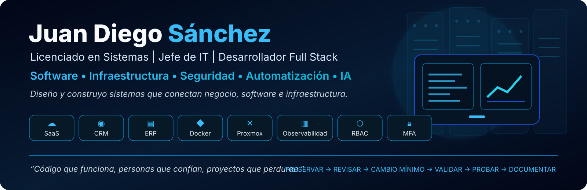

  

  <strong>Sistemas reales. Infraestructura real. Automatización con criterio.</strong> 
  Software empresarial · SaaS · DevOps/SecOps · Observabilidad · IA asistiva

  <a href="#perfil">Perfil</a> ·
  <a href="#proyectos-principales">Proyectos principales</a> ·
  <a href="#otros-proyectos">Portfolio</a> ·
  <a href="#novedades-verificadas">Actualizaciones</a> ·
  <a href="#arquitectura-y-practicas">Arquitectura y prácticas</a> ·
  <a href="#stack-y-metodo">Stack y método</a>

---

## Perfil

Soy **Juan Diego Sánchez**, **Licenciado en Sistemas** y **Jefe de IT**. Diseño, desarrollo y opero soluciones que unen procesos de negocio, software, infraestructura y seguridad.

Mi trabajo se concentra en convertir planillas, operaciones manuales y aplicaciones heredadas en **plataformas integradas, auditables, observables y recuperables**. Me interesan tanto la experiencia del usuario como lo que ocurre después del deploy: permisos, datos, incidencias, backups y mantenimiento.

**Qué abordo:** SaaS multi-tenant · ERP/CRM · portales empresariales · integraciones/API · automatización · modernización legacy · observabilidad · seguridad por diseño.

> **Sobre el portfolio:** varios productos son privados o de uso interno. Comparto alcance y tecnologías sin publicar código restringido, instalaciones de clientes, IPs, credenciales, datos de negocio ni accesos operativos. Los estados de staging, candidata y producción no son equivalentes.

## Proyectos principales

### 🛡️ Apollo WebGuard — Observabilidad y SecOps

Monitoreo y diagnóstico de servidores, servicios, contenedores y disponibilidad. Integra señales de Proxmox, Docker, Nginx, Uptime Kuma, Wazuh, Grafana, Prometheus, Loki y Alertmanager; contempla incidentes, evidencia, alertas, backups y recuperación. **Apollo observa infraestructura; ControlApp administra el portfolio de aplicaciones.**

`Linux` · `Docker` · `Proxmox` · `Prometheus` · `Grafana` · `SecOps`

### 🧭 ControlApp — Gobierno multiaplicación

Plano administrativo para clientes, aplicaciones, entornos, versiones, sesiones, auditoría, backups e incidentes. Usa **adaptadores de solo lectura**, collectors normalizados, catálogo de servicios y permisos por aplicación. Integra señales de Apollo y conectores de Baudo/Toolbox; las acciones remotas de riesgo no reciben ejecución implícita.

`Node.js` · `React` · `PostgreSQL` · `Redis` · `MFA` · `Approval Gate`

### 🏥 Health Turnos — SaaS sanitario multi-tenant

Agenda, pacientes, profesionales, sedes, historia clínica electrónica, laboratorios, radiología, cobros, booking público y colaboración. La **etapa 55** incorpora preparación defensiva para VPS, Turnstile y readiness orientado a WebGuard, sobre la base de Stage 54 (preflight, backups cifrados trazables, restore aislado y recuperación). **Preparación para despliegue no significa servicio público ya habilitado.**

`PostgreSQL` · `Prisma` · `Redis` · `Docker` · `RBAC` · `MFA`

### 💬 WA CRM Sender — Mensajería y automatización multiempresa

CRM, campañas, bandeja de equipo, API de integraciones y webhooks firmados. Su release **v3.14.0** documenta entrega saliente anti-duplicados, control multi-tenant RLS/BOLA, colas, DLQ, Security Gate y ensayo de recuperación.

`Node.js` · `PostgreSQL RLS` · `Redis/BullMQ` · `Workers` · `HMAC`

### 🧰 Toolbox — Utilidades técnicas privacy-first

Aplicación autoalojable con herramientas para PDF, imágenes, OCR, QR, certificados X.509/CSR, GeoIP, red, datos y soporte IT. **v1.0.0 estable**; prioriza procesamiento local, servicios externos explícitos, workers aislados y verificación de release. Preparada para integración de solo lectura con ControlApp sin perder independencia.

`PWA` · `Browser-first` · `Docker` · `Trivy/SBOM` · `E2E`

## Otros proyectos

| Dominio | Producto | Qué resuelve |
|:--|:--|:--|
| Finanzas | **TAU — Tu Administración Unificada** | Espacios personales, familiares y empresariales; cuentas, tarjetas, cuotas, OCR local, conciliación, reintegros y Control Center. |
| Seguros | **BrokerFlow / OLBROKER** | Clientes, pólizas, producción, siniestros, chat, importación transaccional y despliegues controlados Blue/Green. |
| LegalTech | **Baudo** | Gestión jurídica/laboral, expedientes, documentos privados, RRHH, morosidad, timeline y portal cliente. |
| ITSM | **ITFlow / Romera IT Desk** | Portal de tickets y consola técnica con GLPI como fuente de verdad, activos, integraciones y Update Manager. |
| Comercio | **Exabyte ERP Store** | ERP, ecommerce, stock, cuentas corrientes, catálogo, proveedores, pagos, servicio técnico y garantías. |
| Agro | **Silos / Resinta** | Modernización de sistema heredado, concurrencia, importaciones seguras e idempotencia durable. |
| Finanzas | **Financiera RM** | Modernización financiera en entorno LAB, controles por sucursal, auditoría y portal de Soporte IT. |
| Contabilidad | **EstudioRoza Contable** | Portal de clientes y operación contable con control de acceso, auditoría y despliegue endurecido. |
| Comercial | **CRM Romera** | Seguimiento comercial, Timeline 360, colaboración y automatizaciones. |
| Afiliaciones | **Portal STM** | Gestión de afiliados, beneficios y validaciones. |
| Compras | **App Comprar Precios** | Comparación de precios por artículo, cantidad, peso, volumen y unidad. |
| Herramientas internas | **Firma Romera** | Generador institucional de firmas HTML para clientes de correo. |

## Novedades verificadas

**Septiembre–octubre de 2026**, según las últimas revisiones de los repositorios accesibles:

- **Health Turnos — Stage 55:** defensa para despliegue en VPS, integración de Turnstile y preparación para WebGuard.
- **ControlApp + Baudo + Toolbox:** evolución de conectores de observación de solo lectura, contratos de integración, autenticación independiente y correlación operacional. La integración no convierte a ControlApp en una consola de administración remota sin límites.
- **Baudo:** integración privada con ControlApp; el adaptador no se expone en el frontend público y usa secretos separados. Se preserva el principio *fail-closed* para configuración y datos demo.
- **TAU:** actualización operativa del despliegue con permisos *non-root* y acceso restringido a backups.
- **Exabyte ERP Store:** `6.1.4` documentada como base estable y `6.2.0-rc.6` como **candidata**, con catálogo/publicación segura, seriales/garantías, UX e incorporación de QR local para alta TOTP.

<strong>Ver versiones técnicas de otras bases verificadas</strong>

| Sistema | Referencia |
|:--|:--|
| Toolbox | `v1.0.0 estable` |
| ITFlow | `v0.7.1 estable` |
| WA CRM Sender | `v3.14.0` |
| TAU | `v0.6.0` |
| Baudo | `v0.13.0` informado por el runtime documentado; el encabezado histórico de su README conserva una versión anterior |
| Silos / Resinta | `v3.2.1-stage21` |
| Financiera RM | `0.11.0-LAB`, sin conexión/escritura en producción real |

## Arquitectura y prácticas

No hay una única arquitectura para todos los proyectos. Reutilizo **contratos y controles**, no acoplamiento entre bases de datos ni permisos administrativos compartidos.

~~~mermaid
flowchart LR
    U[Usuarios / Integraciones] --> P[HTTPS / Reverse Proxy]
    P --> A[Portales y APIs]
    A --> D[(Datos aislados)]
    A --> Q[Colas / Workers]
    A --> E[Eventos / Auditoría]
    S[Hosts / Contenedores] --> O[Apollo WebGuard]
    A -. Adaptadores read-only .-> C[ControlApp]
    O -. Estado / Incidentes .-> C
    E --> C
~~~

| Seguridad | Confiabilidad | Operación |
|:--|:--|:--|
| RBAC, MFA, mínimo privilegio, BOLA/BFLA, RLS cuando corresponde | Health/readiness, preflight, idempotencia, retry/DLQ | Metrics, logs, correlation IDs, incidentes |
| Secretos fuera del repositorio, scopes/allowlists, auditoría | Backup con prueba de restauración, rollback, Blue/Green según el sistema | Catálogo de servicios, dashboards y evidencia |
| Security Gate, análisis de dependencias/SBOM y revisión humana | CI, tests, E2E, smoke antes de promoción | IA asistiva, sin permisos destructivos implícitos |

## Stack y método

**Desarrollo:** TypeScript, JavaScript, Node.js, React, Next.js, Java/Spring Boot y Python.

**Datos:** PostgreSQL, MySQL/MariaDB, Redis, Prisma y colas de trabajo.

**Infraestructura y seguridad:** Linux/Ubuntu, Docker Compose, Proxmox, Nginx, GitHub Actions, Grafana, Prometheus, Loki, Wazuh, Uptime Kuma, Trivy y ClamAV.

**Forma de trabajo**

> **PRESERVAR → REVISAR → CAMBIO MÍNIMO → VALIDAR → PROBAR → DOCUMENTAR**

Antes de declarar un cambio como terminado: verificar estado real, preservar datos y módulos estables, ejecutar las pruebas aplicables y documentar evidencia y procedimiento de recuperación.

---

  <strong>Software · Infraestructura · Automatización · DevOps · SecOps · IA aplicada</strong> 
  <a href="https://github.com/poto212">Perfil GitHub</a> ·
  <a href="https://github.com/poto212?tab=repositories">Repositorios visibles</a>
   Banner propio alojado en este repositorio. Sin estadísticas inventadas, fotografía embebida ni widgets de métricas externos.

